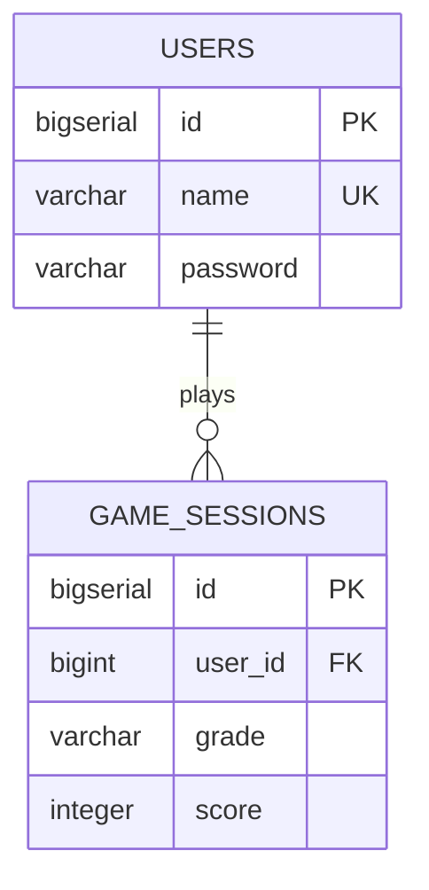

# データベース設計(PostgreSQL)

テーブルは実質2つ。お題データはDB化せず、`resources/js/`側に静的な配列として持つ(管理機能が不要なため)。ランキングは`game_sessions`を`grade`で絞ってスコア順に並べれば作れるので専用テーブルは不要。

## ER概要



## マイグレーションのファイル名順

依存順(親テーブル→子テーブル)でよいのでLaravel標準の命名のまま問題ない:

```
0001_01_01_000000        create_users_table            (標準 + name UNIQUE、email列は削除)
0001_01_01_000001        create_cache_table            (標準)
0001_01_01_000002        create_jobs_table             (標準。本プロジェクトでは未使用だが標準のまま残す)
2026_xx_xx_xxxxxx        create_sessions_table         (標準。SESSION_DRIVER=databaseで使用)
2026_xx_xx_xxxxxx        create_game_sessions_table
```

BreezeのInertia+Reactスターターキットには`password_reset_tokens`マイグレーションも含まれるが、パスワードリセットを実装しないため削除する([backend/auth.md](./auth.md))。

---

## users(Laravel標準を一部変更)

| カラム | 型 | 制約 / 備考 |
|---|---|---|
| id | bigserial | PK |
| name | varchar(255) | UNIQUE。ログインID代わり(メールアドレス不要) |
| password | varchar(255) | bcrypt |
| created_at / updated_at | timestamp | |

Laravel標準の`email` `email_verified_at` `remember_token`列は削除する(メール認証を実装しないため)。

---

## game_sessions

| カラム | 型 | 制約 / 備考 |
|---|---|---|
| id | bigserial | PK |
| user_id | bigint | FK → users、ON DELETE CASCADE |
| grade | varchar(20) | CHECK制約なし。どの級でプレイしたかを表す文字列で、具体的に何が有効な値かはバックエンドは知らない。「有効な級の一覧」はfrontendの`lib/customize/words/`が唯一の正 |
| score | integer | CHECK (score >= 0)。1プレイの完了問題数 |
| created_at / updated_at | timestamp | `created_at`をプレイ日時として使う(`played_at`は別途持たない) |

インデックス: `game_sessions(grade, score)`(級ごとのランキングのORDER BY用)。マイページ(プレイ履歴)機能は持たないため`user_id`単体の検索用インデックスは不要。FKとしての`user_id`は残る

---

## Laravel標準テーブル

`sessions`(セッション認証、`SESSION_DRIVER=database`で実際に使用、[backend/auth.md](./auth.md))、`cache` `jobs` `failed_jobs`(未使用だが標準のまま残す)。Sanctumを使わないため`personal_access_tokens`テーブルは不要。

---

## 代表的なクエリ

### ランキング(級ごと、上位10件固定、同点は先に達成した方が上位)

自己ベストへの絞り込みはせず、プレイ(`game_sessions`の1行)をそのまま順位付けする。そのため同じユーザーが上位10件の中に複数回登場しうる(個人で繰り返し遊ぶ用途での使いやすさを優先した仕様)。「同じスコアなら先に達成した人を上位にする」ため、`score DESC, created_at ASC`で並べる。

```php
DB::select(<<<'SQL'
    SELECT user_id, score AS best_score, created_at AS achieved_at
    FROM game_sessions
    WHERE grade = ?
    ORDER BY score DESC, created_at ASC
    LIMIT 10
SQL, [$grade]);
```

取得した`user_id`群で`User::whereIn('id', ...)`を引いて`name`を紐付ける。ランキングは級ごとに別物なので、トップページのコントローラはリクエストの`grade`クエリパラメータ(省略時は`"1"`)を必須の入力として扱う([api.md](../api.md))。クエリは渡された`grade`文字列でそのままフィルタするだけなので、級の種類が増減してもこのクエリ自体は変更不要。

マイページ(プレイ履歴一覧)機能は持たないため、`user_id`で個人の履歴を取得するクエリは存在しない。`game_sessions`はランキング集計のためだけに書き込まれ、読み取りは上記のランキングクエリのみ。
